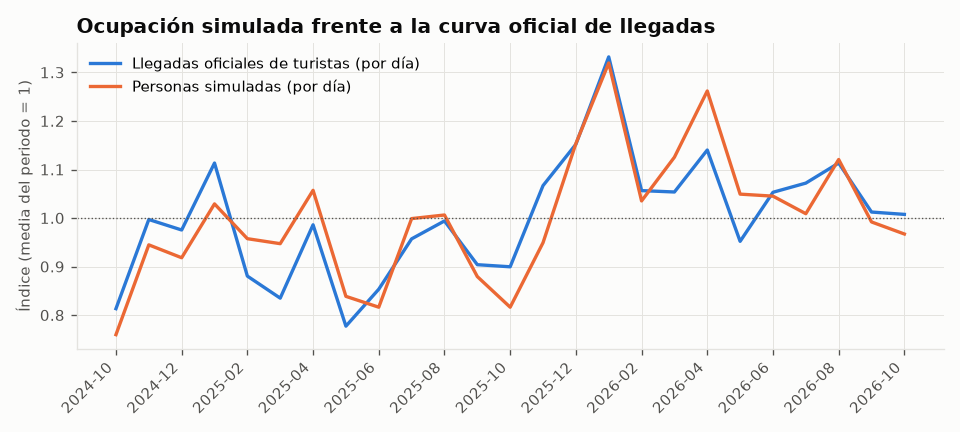
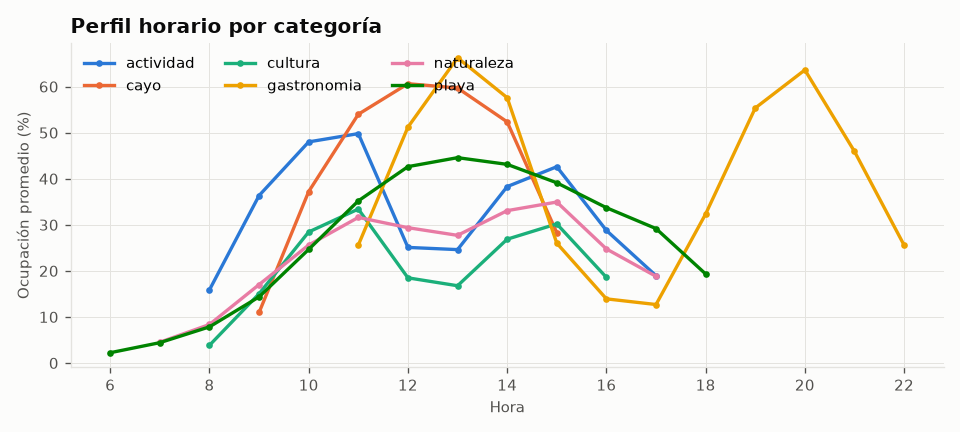
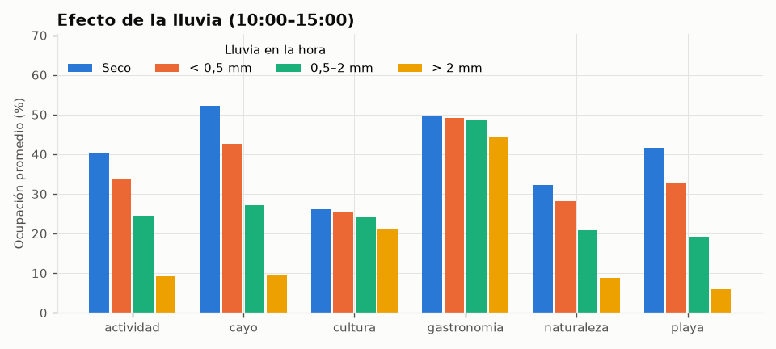

# Calidad del dataset simulado

> ⚠ **Datos SIMULADOS** (`origen_dato = simulado_calibrado`): calibrados con datos reales (clima observado, festivos, llegadas oficiales de turistas, cierres oficiales), pero la ocupación no es una medición real. Fuentes y supuestos en [`ml/datos/FUENTES.md`](../datos/FUENTES.md).

- Filas: **209,440** · destinos: **30** · desde 2024-10-01 hasta 2026-10-18
- Generado con `python generar_dataset_simulado.py` (semilla 42); este reporte con `python calidad_dataset.py`.

## Chequeos

| Chequeo | Resultado | Detalle |
| --- | --- | --- |
| validar_dataset.py | ✔ | sin errores |
| Nunca supera la capacidad | ✔ | 0 filas por encima de la capacidad |
| Muy pocos casos cerca del 100 %, en temporada alta | ✔ | 14 filas ≥ 95 % (0.007%); 100% de ellas en temporada alta, festivo o puente |
| Promedios por categoría y mes plausibles | ✔ | entre 17.6 % y 57.6 % (rango aceptado 5–80 %) |
| La lluvia reduce la ocupación al aire libre | ✔ | correlación lluvia–ocupación en playas y cayos (10:00–15:00) = -0.53 |
| La ocupación mensual sigue la curva oficial de llegadas | ✔ | correlación = 0.87; mayor desvío mensual = 13% (lluvia, viento y cierres) |
| Sin huecos ni duplicados | ✔ | todas las horas de atención de todos los días |

## Días atípicos (filas)

| Evento | Filas |
| --- | --- |
| normal | 205,821 |
| cierre_mal_tiempo | 2,247 |
| cierre_judicial | 1,288 |
| cierre_descanso | 84 |

## Ocupación promedio por categoría y mes (%, sin días cerrados)

| mes | actividad | cayo | cultura | gastronomia | naturaleza | playa |
| --- | --- | --- | --- | --- | --- | --- |
| 2024-10 | 26.9 | 33.8 | 18.5 | 34.7 | 18.7 | 19.5 |
| 2024-11 | 33.2 | 39.2 | 22.4 | 42.3 | 23.1 | 23.7 |
| 2024-12 | 31.6 | 40.7 | 22.5 | 40.8 | 23.2 | 23.5 |
| 2025-01 | 36.5 | 44.8 | 25.6 | 45.9 | 26.6 | 27.8 |
| 2025-02 | 31.9 | 40.9 | 19.9 | 38.0 | 23.1 | 24.9 |
| 2025-03 | 32.0 | 40.9 | 19.3 | 35.9 | 22.0 | 24.7 |
| 2025-04 | 36.4 | 45.7 | 21.6 | 40.3 | 25.5 | 27.9 |
| 2025-05 | 28.7 | 36.0 | 17.6 | 33.6 | 20.0 | 21.9 |
| 2025-06 | 27.4 | 34.3 | 19.0 | 36.4 | 20.1 | 21.0 |
| 2025-07 | 33.8 | 43.2 | 22.2 | 40.1 | 24.3 | 25.9 |
| 2025-08 | 35.3 | 44.1 | 22.6 | 42.2 | 25.4 | 26.5 |
| 2025-09 | 31.6 | 39.7 | 20.1 | 38.3 | 22.1 | 23.9 |
| 2025-10 | 29.9 | 36.7 | 20.1 | 38.4 | 20.4 | 21.9 |
| 2025-11 | 35.3 | 44.4 | 23.4 | 44.0 | 24.7 | 26.1 |
| 2025-12 | 40.6 | 51.2 | 26.6 | 48.4 | 28.8 | 31.9 |
| 2026-01 | 47.6 | 57.6 | 30.8 | 53.0 | 35.3 | 36.9 |
| 2026-02 | 38.3 | 47.4 | 24.7 | 45.3 | 27.4 | 29.2 |
| 2026-03 | 38.7 | 47.8 | 24.1 | 43.8 | 27.2 | 29.3 |
| 2026-04 | 42.7 | 54.2 | 25.9 | 46.7 | 29.8 | 33.7 |
| 2026-05 | 35.6 | 45.1 | 21.9 | 41.1 | 25.3 | 27.3 |
| 2026-06 | 35.7 | 43.1 | 24.3 | 43.7 | 25.9 | 27.7 |
| 2026-07 | 33.7 | 41.7 | 23.6 | 44.8 | 25.7 | 26.7 |
| 2026-08 | 37.8 | 46.1 | 25.5 | 46.0 | 27.5 | 30.1 |
| 2026-09 | 34.7 | 44.0 | 23.4 | 43.3 | 25.0 | 25.5 |
| 2026-10 | 37.2 | 44.7 | 22.1 | 41.8 | 25.0 | 24.8 |

## Correlación lluvia–ocupación por categoría (10:00–15:00)

| categoria | correlación |
| --- | --- |
| actividad | -0.28 |
| cayo | -0.37 |
| cultura | -0.09 |
| gastronomia | -0.05 |
| naturaleza | -0.37 |
| playa | -0.4 |

## Curva mensual

| mes | llegadas_dia | personas_dia | indice_llegadas | indice_ocupacion |
| --- | --- | --- | --- | --- |
| 2024-10 | 2639.29 | 21515.87 | 0.81 | 0.76 |
| 2024-11 | 3235.43 | 26755.2 | 1.0 | 0.94 |
| 2024-12 | 3165.32 | 26003.39 | 0.98 | 0.92 |
| 2025-01 | 3612.9 | 29145.26 | 1.11 | 1.03 |
| 2025-02 | 2857.14 | 27115.57 | 0.88 | 0.96 |
| 2025-03 | 2709.68 | 26824.45 | 0.84 | 0.95 |
| 2025-04 | 3200.0 | 29936.6 | 0.99 | 1.06 |
| 2025-05 | 2522.39 | 23750.9 | 0.78 | 0.84 |
| 2025-06 | 2769.4 | 23118.67 | 0.85 | 0.82 |
| 2025-07 | 3106.03 | 28287.1 | 0.96 | 1.0 |
| 2025-08 | 3225.81 | 28497.68 | 0.99 | 1.01 |
| 2025-09 | 2933.33 | 24904.8 | 0.9 | 0.88 |
| 2025-10 | 2919.35 | 23118.1 | 0.9 | 0.82 |
| 2025-11 | 3461.9 | 26881.23 | 1.07 | 0.95 |
| 2025-12 | 3738.26 | 32661.87 | 1.15 | 1.15 |
| 2026-01 | 4322.58 | 37366.68 | 1.33 | 1.32 |
| 2026-02 | 3428.57 | 29318.86 | 1.06 | 1.04 |
| 2026-03 | 3419.35 | 31869.71 | 1.05 | 1.13 |
| 2026-04 | 3700.0 | 35732.6 | 1.14 | 1.26 |
| 2026-05 | 3089.39 | 29714.84 | 0.95 | 1.05 |
| 2026-06 | 3417.43 | 29597.4 | 1.05 | 1.05 |
| 2026-07 | 3478.74 | 28573.52 | 1.07 | 1.01 |
| 2026-08 | 3612.9 | 31735.45 | 1.11 | 1.12 |
| 2026-09 | 3285.33 | 28091.83 | 1.01 | 0.99 |
| 2026-10 | 3269.68 | 27388.06 | 1.01 | 0.97 |

## Gráficos

