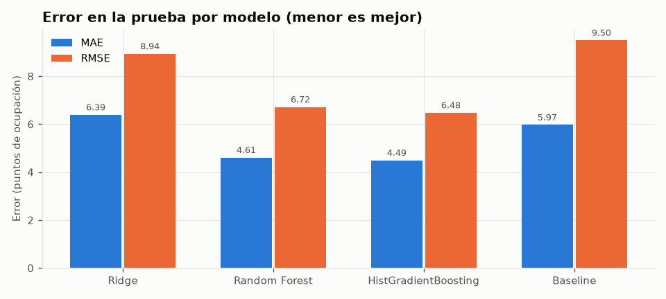
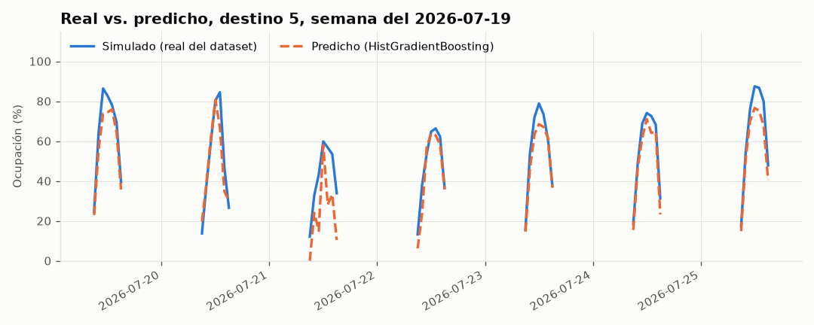
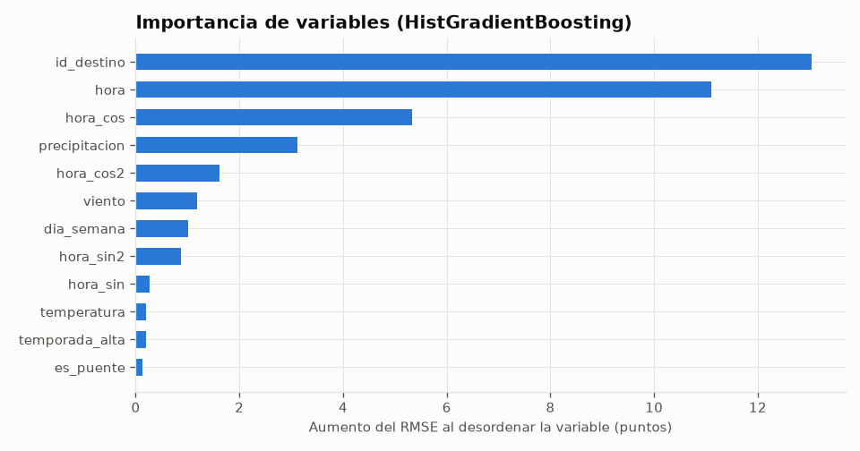

# Comparación de modelos de ocupación

> ⚠ **Datos SIMULADOS** (`simulado_calibrado`): calibrados con datos reales, pero la ocupación no es una medición real. Las métricas muestran que el sistema funciona y comparan los modelos entre sí; no son la precisión que tendrán con datos reales.

- Fecha: 2026-10-21T00:00:50+00:00 · datos: **simulado** (`dataset_ocupacion_san_andres.csv`), 208,068 filas, 2024-10-01 a 2026-10-18
- Validación temporal: entrenamiento hasta el 2026-07-19 (182,329 filas); prueba con los últimos 3 meses (25,739 filas).
- Hiperparámetros: RandomizedSearchCV (semilla 42) con TimeSeriesSplit de 3 pliegues sobre una muestra ordenada de hasta 60,000 filas del entrenamiento.
- Criterio: Menor RMSE en la prueba (últimos 3 meses); si la diferencia es menor al 2%, el más liviano. Restricciones: ≤ 50 MB y < 100 ms por predicción.

## Resultados en la prueba

| Modelo | MAE | RMSE | R² | RMSE con clima nulo | Entrenamiento (s) | Archivo (MB) | Predicción (ms) | Memoria al cargar (MB) | Cumple restricciones |
| --- | --- | --- | --- | --- | --- | --- | --- | --- | --- |
| Ridge (regresión lineal regularizada) | 6.39 | 8.94 | 0.808 | 10.48 | 4.0 | 0.01 | 8.27 | 1.1 | sí |
| Random Forest | 4.61 | 6.72 | 0.892 | 9.93 | 72.7 | 14.15 | 16.19 | 74.4 | sí |
| **HistGradientBoosting** 🏆 | 4.49 | 6.48 | 0.899 | 9.61 | 7.4 | 0.64 | 11.20 | 4.3 | sí |
| Baseline (promedio por destino y hora) | 5.97 | 9.50 | 0.784 | 9.50 | — | — | — | — | — |

MAE y RMSE en puntos porcentuales de ocupación (0–100).

## Ganador: HistGradientBoosting

Menor RMSE en la prueba (6.48 puntos). Ningún otro modelo quedó a menos del 2%.

Hiperparámetros: `{"min_samples_leaf": 50, "max_leaf_nodes": 31, "max_iter": 400, "learning_rate": 0.1, "l2_regularization": 1.0}`. Los tres modelos se reentrenaron con todas las filas y se guardaron en `ml/artefactos/`.

## Producción y respaldo

- En uso: **HistGradientBoosting** (el único que el servicio carga al arrancar).
- Orden de respaldo si el ganador no carga: HistGradientBoosting → Random Forest → Ridge (regresión lineal regularizada).

| Modelo | Archivo | Tamaño (MB) | Versionado |
| --- | --- | --- | --- |
| Ridge (regresión lineal regularizada) | ridge.joblib | 0.01 | sí |
| Random Forest | random_forest.joblib | 15.12 | sí |
| HistGradientBoosting | gradient_boosting.joblib | 0.65 | sí |

## Reducción de tamaño

- Random Forest: De 18.94 MB a 14.15 MB con RMSE 6.718 (antes 6.652; límite 6.785). Objetivo 15 MB; RMSE máximo aceptado 6.785.
  - {'max_depth': 16}: RMSE 6.718, 14.15 MB

## MAE por categoría

| Modelo | actividad | cayo | cultura | gastronomia | naturaleza | playa |
| --- | --- | --- | --- | --- | --- | --- |
| Ridge (regresión lineal regularizada) | 8.76 | 7.72 | 3.95 | 7.69 | 4.18 | 5.01 |
| Random Forest | 5.47 | 6.67 | 3.30 | 5.17 | 3.39 | 3.82 |
| HistGradientBoosting | 5.52 | 6.69 | 2.98 | 4.89 | 3.46 | 3.63 |
| Baseline (promedio por destino y hora) | 7.11 | 9.91 | 2.85 | 5.29 | 4.20 | 5.83 |

## MAE por temporada

| Modelo | alta | normal |
| --- | --- | --- |
| Ridge (regresión lineal regularizada) | 6.73 | 6.35 |
| Random Forest | 4.87 | 4.58 |
| HistGradientBoosting | 5.89 | 4.32 |
| Baseline (promedio por destino y hora) | 6.50 | 5.91 |

## Hiperparámetros elegidos

- Ridge (regresión lineal regularizada): `{"alpha": 1.0}`
- Random Forest: `{"n_estimators": 100, "min_samples_leaf": 10, "max_features": 1.0, "max_depth": 16}`
- HistGradientBoosting: `{"min_samples_leaf": 50, "max_leaf_nodes": 31, "max_iter": 400, "learning_rate": 0.1, "l2_regularization": 1.0}`

## Gráficos

## Advertencias

- Entrenado con datos SIMULADOS (calibrados con datos reales): las predicciones son una demostración, no reflejan la afluencia real.
